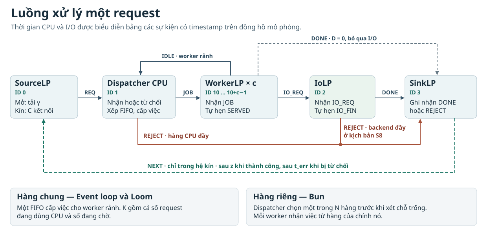
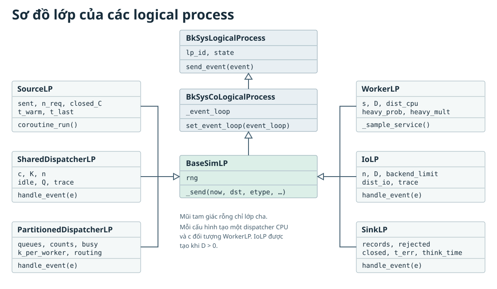

# Sơ đồ kiến trúc và sơ đồ lớp

Một request đi vào trạm CPU, chờ đến lượt nếu các worker đang bận, sử dụng CPU đúng một lần rồi chuyển sang trạm chờ I/O. Worker nhả ngay sau khi hoàn tất phần CPU và nhận việc kế tiếp dù các request trước vẫn đang chờ I/O. Cách tổ chức hàng đợi giữa các worker và chi phí điều phối luồng quyết định hàng nào đầy trước, thời gian chờ tại CPU và trần thông lượng của hệ thống.

## 1. Ba kiến trúc trạm CPU

Gọi `s` là thời gian phục vụ CPU cơ sở trung bình của một request (tính bằng giây), `D` là thời gian chờ I/O trung bình, `c` là số worker (hoặc `N` đối với Bun) và `K` là tổng sức chứa của trạm CPU (tính cả các request đang chạy trên worker lẫn các request đang xếp hàng chờ).

| Hệ được mô hình hóa | Tổ chức hàng đợi tại trạm CPU | Sức chứa cơ sở (E1) | Trần thông lượng thành công `X_max` |
|---|---|---|---|
| Event loop (`asyncio` / Node.js) | Một hàng FIFO duy nhất, `c = 1` worker (`M/M/1/K`) | `K = 100` | `1 / s` |
| Bun (Multi-Kernel Thread) | `N = 8` kernel thread độc lập, mỗi thread một FIFO và một worker (`N × M/M/1/(K/N)`) | Tổng `K = 800` (`100` chỗ/hàng) | `N / (κ · s)` |
| Spring Loom (Virtual Thread) | Một hàng FIFO chung cấp việc cho `c = 8` carrier thread (`M/M/c/K`) | Tổng `K = 800` | `c / s` |

Trong mã nguồn, mỗi hàng con của `PartitionedDispatcherLP` (Bun) có sức chứa `k_per_worker = max(1, K // c)`. Chế độ phân luồng mặc định `routing = "random"` tách dòng đến Poisson tốc độ `γ` thành `N` dòng Poisson độc lập có tốc độ `γ / N`, nhờ đó mỗi kernel thread tương ứng chính xác với một trạm `M/M/1/(K/N)` có công thức giải tích đóng. Mã nguồn cũng hỗ trợ tùy chọn `routing = "rr"` (Round-Robin, khi đó khoảng thời gian giữa hai lượt đến cùng một hàng mang phân phối Erlang thay vì phân phối mũ); toàn bộ bộ số liệu chuẩn sử dụng `routing = "random"` để đối chiếu nhất quán với giải tích. Hệ số `κ ∈ {1,0; 1,25; 1,5}` biểu diễn chi phí chuyển ngữ cảnh và đồng bộ hóa của kernel thread bằng cách nhân thời gian phục vụ CPU thành `s_eff = κ · s` (`κ = 1,0` dùng để cô lập riêng ảnh hưởng của việc chia tách hàng đợi; `κ = 1,25` là cấu hình mặc định của Bun trong các phép quét đa nhân). [Cấu hình tham số](../SPE-dev-backup/scenarios/config.py) · [Công thức giải tích](../SPE-dev-backup/scenarios/analytical.py)

## 2. Luồng sự kiện và sơ đồ lớp thực thi

1. **`SourceLP` (ID 0)** phát sự kiện `REQ` mang mã định danh `rid` và dấu thời gian đến `t_arr` tới bộ điều phối CPU. Ở chế độ hệ mở (`closed_C = 0`), sự kiện `ARRIVAL` kế tiếp được tự hẹn theo phân phối mũ tốc độ `γ` độc lập với phản hồi. Ở chế độ hệ kín (`closed_C = C > 0`), `C` kết nối đồng thời gửi loạt yêu cầu đầu tiên tại `t = 0`.
2. **Dispatcher CPU (ID 1 — `SharedDispatcherLP` hoặc `PartitionedDispatcherLP`)** nhận `REQ`. Nếu trạm (hoặc hàng con được chọn ở Bun) còn chỗ, request được nhận vào hệ thống và cấp ngay sự kiện `JOB` (kèm `t_start`) cho một worker rảnh, hoặc xếp vào hàng đợi FIFO nếu mọi worker tương ứng đang bận. Nếu đã đầy (`n = K` hoặc `counts[w] = k_per_worker`), bộ điều phối gửi ngay `REJECT` về `SinkLP`.
3. **`WorkerLP` (ID `10` đến `10 + c − 1`)** nhận `JOB`, lấy mẫu thời gian phục vụ CPU (phân phối mũ `exp` hoặc cố định `det`; có thể nhân hệ số `heavy_mult` với xác suất `heavy_prob` ở kịch bản S10) và tự hẹn sự kiện `SERVED` tại `t + dur`. Khi `SERVED` xảy ra, worker gửi `IDLE` trả lại cho Dispatcher để nhận việc mới ngay lập tức, đồng thời chuyển request sang `IoLP` bằng `IO_REQ` (hoặc gửi thẳng `DONE` tới `SinkLP` nếu `D = 0`).
4. **`IoLP` (ID 2, khởi tạo khi `D > 0`) và `SinkLP` (ID 3)**: `IoLP` tự hẹn `IO_FIN` riêng cho từng request để mô phỏng trạm `M/M/∞` không chặn; riêng ở kịch bản S8 (`backend_limit` hữu hạn), nếu số phiên I/O đang treo đạt ngưỡng `backend_limit`, `IoLP` gửi ngay `REJECT` về `SinkLP`. `SinkLP` ghi nhận các request hoàn tất (`DONE`) hoặc bị từ chối (`REJECT`); ở hệ kín, `SinkLP` lập lịch sự kiện `NEXT` quay về `SourceLP` sau thời gian nghĩ `think_time` (`z`) khi thành công hoặc sau độ trễ thử lại `t_err` khi bị từ chối. Toàn bộ độ trễ được mô hình hóa bằng dấu thời gian mô phỏng, không sử dụng tham số `timeout` đồng hồ thật của coroutine; kịch bản sự kiện `TIMEOUT` mức ứng dụng được giữ là hướng mở rộng ngoài phạm vi bộ số liệu chuẩn theo §3.2 của notebook thiết kế.

Hàm `run_simulation(SimConfig)` khởi tạo các LP nghiệp vụ kế thừa từ `BaseSimLP` → `BkSysCoLogicalProcess` → `BkSysLogicalProcess`. Hai lớp `SharedDispatcherLP` và `PartitionedDispatcherLP` quyết định **worker nghiệp vụ nào nhận request**, trong khi ở tầng lõi `bkitevsim`, `Simulation` kích hoạt `BkSysCoEventLoop` để lập lịch **sự kiện mô phỏng kế tiếp** theo dấu thời gian cho mọi LP dạng coroutine (do đó hai giá trị cấu hình `sequential` và `distributed_sequential` đều đi qua cùng vòng lặp sự kiện coroutine và cho kết quả tương đương). Với hàng đợi sự kiện `LadderQueue` của thư viện môn học (sử dụng mảng vòng 1.024 bucket), `simulator_app.py` chủ động đặt độ rộng mỗi bucket là `bucket_width = max(t_end / 900, 10⁻³)`, đảm bảo toàn bộ khoảng thời gian mô phỏng `t_end` luôn nằm gọn trong tối đa `900 < 1.024` bucket nên không xảy ra hiện tượng quay vòng modulo làm đảo thứ tự thời gian sự kiện trong bất kỳ lượt chạy thực nghiệm nào. [Các lớp LP nghiệp vụ](../SPE-dev-backup/scenarios/async_runtime_lps.py) · [Bộ điều phối mô phỏng](../SPE-dev-backup/apps/simulator_app.py) · [Lõi Simulation](../SPE-dev-backup/bkitevsim/core/simulation.py)

[Bảy câu hỏi nghiên cứu và kết quả định lượng](../SPE-dev-backup/docs/architecture.md) · [Kiểm chứng và đánh giá](../Validation%20and%20evaluation/README.md)
