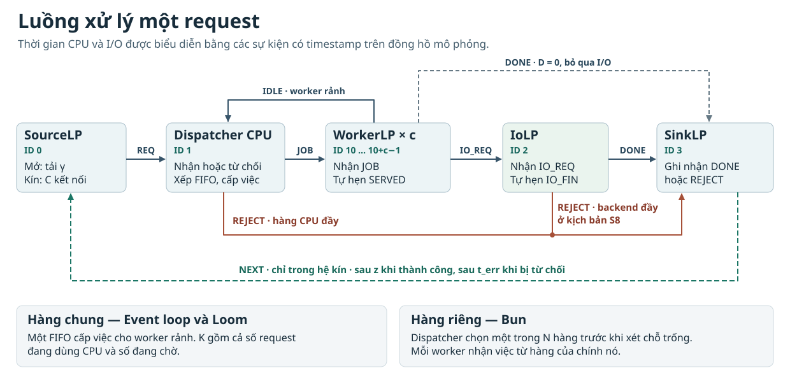
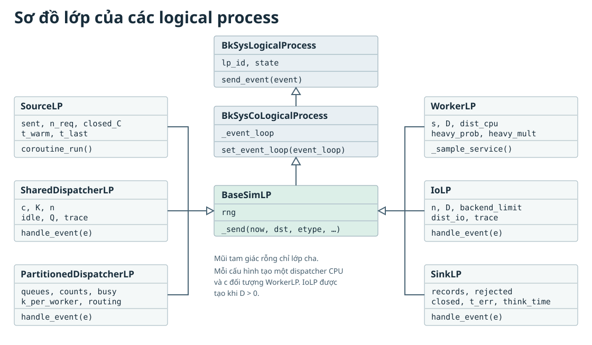

<!-- coderabbit-ai-generated:v1 -->

<!-- coderabbit-ai-generated-section:v1:e3edbd8679d77f0fc865f51db01c6a30a2fe455d32c945c902e5fca9abf46ec1 -->

# Kiến trúc và đánh giá hiệu năng mô hình bất đồng bộ

Các kết quả định lượng bên dưới thuộc phiên bản trước khi sửa phép đo, không phải kết quả đã kiểm chứng của phiên bản hiện tại.

<!-- /coderabbit-ai-generated:v1 -->

Một request đi vào trạm CPU, chờ đến lượt nếu các worker đang bận, sử dụng CPU đúng một lần rồi chuyển sang trạm chờ I/O. Worker nhả ngay sau khi hoàn tất phần CPU và nhận việc kế tiếp dù các request trước vẫn đang chờ I/O. Cách tổ chức hàng đợi giữa các worker và chi phí điều phối luồng quyết định hàng nào đầy trước, thời gian chờ tại CPU và trần thông lượng của hệ thống.

**Tổng quan kết quả Phase 2.** Bộ dữ liệu chuẩn trong `results/` gồm **7 tệp CSV**: 5 tệp thực nghiệm (`e1`–`e5`) chứa **124 dòng cấu hình** (tương ứng **120 cấu hình tham số độc lập** với `10` seed `100..109` mỗi cấu hình), tệp dữ liệu gốc từng lượt chạy `raw_seed_runs.csv` (**1.240 dòng**), và bảng kiểm chứng `verification_summary.csv` gồm **18 cấu hình trạm đơn** (`6` mô hình × `3` mức tải × `15` seed `1..15`, đạt `18/18` tiêu chí sai số `< 5%`). Ở cùng năng lực CPU (`c = 8, κ = 1, γ = 7.000 req/s, K = 160`), hàng chung của Spring Loom không từ chối request nào (`P_block = 0%`, `R = 51,95 ms`), trong khi hàng riêng của Bun từ chối `0,909%` và có `R = 56,88 ms` (`p_pair = 2,69 × 10⁻¹⁴`). Khi tính thêm hệ số chi phí kernel thread `κ = 1,25` ở `γ = 7.500 req/s, K = 80`, tỷ lệ từ chối của Bun tăng lên `18,059%` so với `0,075%` của Loom. Trên hệ kín (`E4`), cả `30/30` cấu hình ở cả hai nhánh bộ đệm hữu hạn và vô hạn đều thỏa mãn Định luật Little với sai lệch tối đa chỉ `0,65%`. [Dữ liệu từng seed](../results/raw_seed_runs.csv) · [Bản phân tích tự động](../results/figures/analysis_summary.md)

## 1. Ba kiến trúc trạm CPU

Gọi `s` là thời gian phục vụ CPU cơ sở trung bình của một request (tính bằng giây), `D` là thời gian chờ I/O trung bình, `c` là số worker (hoặc `N` đối với Bun) và `K` là tổng sức chứa của trạm CPU (tính cả các request đang chạy trên worker lẫn các request đang xếp hàng chờ).

| Hệ được mô hình hóa | Tổ chức hàng đợi tại trạm CPU | Sức chứa cơ sở (E1) | Trần thông lượng thành công `X_max` |
|---|---|---|---|
| Event loop (`asyncio` / Node.js) | Một hàng FIFO duy nhất, `c = 1` worker (`M/M/1/K`) | `K = 100` | `1 / s` |
| Bun (Multi-Kernel Thread) | `N = 8` kernel thread độc lập, mỗi thread một FIFO và một worker (`N × M/M/1/(K/N)`) | Tổng `K = 800` (`100` chỗ/hàng) | `N / (κ · s)` |
| Spring Loom (Virtual Thread) | Một hàng FIFO chung cấp việc cho `c = 8` carrier thread (`M/M/c/K`) | Tổng `K = 800` | `c / s` |

Trong mã nguồn, mỗi hàng con của `PartitionedDispatcherLP` (Bun) có sức chứa `k_per_worker = max(1, K // c)`. Chế độ phân luồng mặc định `routing = "random"` tách dòng đến Poisson tốc độ `γ` thành `N` dòng Poisson độc lập có tốc độ `γ / N`, nhờ đó mỗi kernel thread tương ứng chính xác với một trạm `M/M/1/(K/N)` có công thức giải tích đóng. Mã nguồn cũng hỗ trợ tùy chọn `routing = "rr"` (Round-Robin, khi đó khoảng thời gian giữa hai lượt đến cùng một hàng mang phân phối Erlang thay vì phân phối mũ); toàn bộ bộ số liệu chuẩn sử dụng `routing = "random"` để đối chiếu nhất quán với giải tích. Hệ số `κ ∈ {1,0; 1,25; 1,5}` biểu diễn chi phí chuyển ngữ cảnh và đồng bộ hóa của kernel thread bằng cách nhân thời gian phục vụ CPU thành `s_eff = κ · s` (`κ = 1,0` dùng để cô lập riêng ảnh hưởng của việc chia tách hàng đợi; `κ = 1,25` là cấu hình mặc định của Bun trong các phép quét đa nhân). [Cấu hình tham số](../scenarios/config.py) · [Công thức giải tích](../scenarios/analytical.py)

## 2. Luồng sự kiện và sơ đồ lớp thực thi

1. **`SourceLP` (ID 0)** phát sự kiện `REQ` mang mã định danh `rid` và dấu thời gian đến `t_arr` tới bộ điều phối CPU. Ở chế độ hệ mở (`closed_C = 0`), sự kiện `ARRIVAL` kế tiếp được tự hẹn theo phân phối mũ tốc độ `γ` độc lập với phản hồi. Ở chế độ hệ kín (`closed_C = C > 0`), `C` kết nối đồng thời gửi loạt yêu cầu đầu tiên tại `t = 0`.
2. **Dispatcher CPU (ID 1 — `SharedDispatcherLP` hoặc `PartitionedDispatcherLP`)** nhận `REQ`. Nếu trạm (hoặc hàng con được chọn ở Bun) còn chỗ, request được nhận vào hệ thống và cấp ngay sự kiện `JOB` (kèm `t_start`) cho một worker rảnh, hoặc xếp vào hàng đợi FIFO nếu mọi worker tương ứng đang bận. Nếu đã đầy (`n = K` hoặc `counts[w] = k_per_worker`), bộ điều phối gửi ngay `REJECT` về `SinkLP`.
3. **`WorkerLP` (ID `10` đến `10 + c − 1`)** nhận `JOB`, lấy mẫu thời gian phục vụ CPU (phân phối mũ `exp` hoặc cố định `det`; có thể nhân hệ số `heavy_mult` với xác suất `heavy_prob` ở kịch bản S10) và tự hẹn sự kiện `SERVED` tại `t + dur`. Khi `SERVED` xảy ra, worker gửi `IDLE` trả lại cho Dispatcher để nhận việc mới ngay lập tức, đồng thời chuyển request sang `IoLP` bằng `IO_REQ` (hoặc gửi thẳng `DONE` tới `SinkLP` nếu `D = 0`).
4. **`IoLP` (ID 2, khởi tạo khi `D > 0`) và `SinkLP` (ID 3)**: `IoLP` tự hẹn `IO_FIN` riêng cho từng request để mô phỏng trạm `M/M/∞` không chặn; riêng ở kịch bản S8 (`backend_limit` hữu hạn), nếu số phiên I/O đang treo đạt ngưỡng `backend_limit`, `IoLP` gửi ngay `REJECT` về `SinkLP`. `SinkLP` ghi nhận các request hoàn tất (`DONE`) hoặc bị từ chối (`REJECT`); ở hệ kín, `SinkLP` lập lịch sự kiện `NEXT` quay về `SourceLP` sau thời gian nghĩ `think_time` (`z`) khi thành công hoặc sau độ trễ thử lại `t_err` khi bị từ chối. Toàn bộ độ trễ được mô hình hóa bằng dấu thời gian mô phỏng, không sử dụng tham số `timeout` đồng hồ thật của coroutine; kịch bản sự kiện `TIMEOUT` mức ứng dụng được giữ là hướng mở rộng ngoài phạm vi bộ số liệu chuẩn theo §3.2 của notebook thiết kế.

<!-- coderabbit-ai-generated:v1 -->

<!-- coderabbit-ai-generated-section:v1:13f65820057cebff91428e3381618fa3301cfece68ffa51abf69b1b6fdb97dd9 -->

Hàm `run_simulation(SimConfig)` dựng các LP trên `BkSysCoEventLoop`. `LadderQueue` dùng chỉ số bucket tuyệt đối để bảo toàn thứ tự sự kiện qua nhiều chu kỳ bucket; độ rộng bucket do bộ mô phỏng cấu hình. Hai giá trị dispatcher cho LP coroutine đều đi qua cùng vòng lặp sự kiện. [Bộ mô phỏng](../apps/simulator_app.py) · [Hàng đợi](../bkitevsim/queues/ladder_queue.py)

<!-- /coderabbit-ai-generated:v1 -->

## 3. Ánh xạ thiết kế thực nghiệm (§8) và bộ dữ liệu Phase 2

Trong **hệ mở**, dòng đến tuân theo quá trình Poisson tốc độ `γ` (req/s); tỉ số tải chuẩn hóa của một hệ là `ρ_ref = γ / X_max` (với bốn mức tham chiếu WL1–WL4 là `0,30; 0,70; 0,95; 1,10`). Trong **hệ kín**, `C` kết nối duy trì vòng lặp khép kín với thời gian nghĩ `z = 0` và thời gian chờ sau lỗi `t_err = 10 ms` (§7.1). Ba hồ sơ thời gian phục vụ `(s, D)` gồm W1 thiên về I/O `(0,2 ms; 50 ms)`, W2 thiên về CPU `(5 ms; 1 ms)` và W3 cơ sở `(1 ms; 50 ms)`.

| Thiết kế §8 | Nguồn CSV trong `results/` | Phạm vi đã thực thi và biểu đồ đầu ra TV3 |
|---|---|---|
| **E1** · Quét tải `γ` đến bão hòa | `e1_throughput_curves.csv` (`44` dòng) | **4 hệ** (`EventLoop c=1`, `Loom c=8`, `Bun c=8` với `κ = 1,0` và `κ = 1,25`) × **11 mức tải chung** `γ ∈ {200, 500, 800, 1.000, 1.200, 2.000, 4.000, 6.000, 7.000, 8.000, 10.000}` req/s (`n_req = 45.000` từ `γ ≥ 6.000`, bổ sung mốc `7.000` ngay trước ngưỡng bão hòa `8.000`). Xuất **H1**, **H2**, lát cắt tải của **H3** và bản đồ nhiệt **H4**. |
| **E2** · Hệ kín (`C` kết nối) | `e4_closed_loop.csv` (`30` dòng) + `raw_seed_runs.csv` | **3 hệ** × **5 mức kết nối** `C ∈ {100, 500, 1.500, 3.000, 5.000}` × **2 chế độ sức chứa**: `K` hữu hạn (`K = 200` cho Event loop, `K = 800` cho Loom/Bun, `n_req = max(40.000, 100·C)` lên tới `500.000` request) và `K = ∞` (`K = 10⁹`, `n_req = max(40.000, 40·C)`). Xuất **H7** với dải CI95 tính trực tiếp từ tích trên từng seed. |
| **E3** · Độ nhạy `D`, `s` và `κ` | `e3_loom_vs_bun_sensitivity.csv` (`16` dòng, `14` cấu hình độc lập) | Gồm 3 lát cắt OFAT: (1) quét `κ ∈ {1,0; 1,25; 1,5}` cho Bun kèm mốc đối chứng `SpringLoom κ = 1,0` tại `γ = 7.000, K = 160`; (2) quét `D ∈ {10, 50, 200} ms` cho Loom và Bun tại `γ = 6.000, s = 1 ms`; (3) quét `s ∈ {0,5; 1,0; 2,0} ms` cho Loom và Bun tại `γ = 6.000, D = 50 ms` (chuyển tiếp từ I/O-bound sang CPU-bound). Xuất **H4**, **H5**, `sensitivity_kappa` và `sensitivity_s`. |
| **E4** · Sức chứa `K` và số core `c` | `e2_capacity_delay.csv` (`30` dòng, `28` cấu hình độc lập) | Gồm 2 nhánh tại `γ = 7.500 req/s`: (1) quét `K ∈ {16, 40, 80, 200, 800}` (`K/c ∈ {2..100}`) tại `c = 8` với 2 phân phối CPU (`exp`, `det`) cho Loom và Bun `κ = 1,25`; (2) quét `c ∈ {1, 2, 4, 8, 16}` tại `K = 200, CPU exp` cho hàng chung và Bun `κ = 1,25`. Xuất **H3**, **H6**, `loom_vs_bun` và `sensitivity_c`. |
| **E5** · Kiểm chứng giải tích | `verification_summary.csv` (`18` dòng) + các cột `ana_*` | **6 mô hình hàng đợi chuẩn** (`M/M/1`, `M/M/1/K`, `M/M/∞`, `M/M/c/c`, `M/M/c`, `M/M/c/K`) × **3 mức tải** (`low`, `mid`, `high`), mỗi cấu hình `15` seed (`1..15`), xuất đầy đủ `X, W, L, P_block` kèm CI95. Xuất bảng **H8** (`fig8_verification.md`). |
| **§7.4** · Kịch bản mở rộng S8, S10 | `e5_special_scenarios.csv` (`4` dòng) | **S8** giới hạn kết nối backend `backend_limit = 300` tại `γ = 7.000, c = 8, K = 400` cho Loom (`κ = 1`) và Bun (`κ = 1,25`). **S10** đưa `5%` tác vụ CPU nặng gấp `20` lần tại `γ = 900` trên Event loop (`c = 1, K = 200`) và Loom (`c = 8, K = 800`). Xuất `s8_backend` và `s10_long_cpu`. |
| **E6** · Thiết kế giai thừa `2³` | Ngoài phạm vi 6 CSV của bản phân công | Bản phân công Phase 2 (`Assign_tasks.docx`) giao E1–E5; `plotting_app.py` đã cài sẵn hàm ANOVA `2³` tự động chạy ngay khi có tệp `e6*.csv`. |

Mọi cấu hình trong `e1`–`e5` được lặp trên cùng bộ `10` hạt giống `100..109` (kỹ thuật Common Random Numbers), tổng hợp trung bình, độ lệch chuẩn mẫu và khoảng tin cậy 95% theo phân phối t-Student (`df = 9`), đồng thời lưu chi tiết từng lượt chạy trong `raw_seed_runs.csv`. Hai điểm gốc dùng chung giữa các nhánh quét ở `e2` (`c = 8, K = 200, exp`) và `e3` (`D = 50 ms, s = 1,0 ms`) được `plotting_app.py` tự động kiểm tra trùng khớp trị số và gộp lại thành `28` và `14` cấu hình độc lập khi lập bảng thống kê để tránh tính trùng. [Bộ chạy thực nghiệm](../apps/benchmark_experiments_app.py) · [Ứng dụng vẽ biểu đồ và phân tích](../apps/plotting_app.py)

## 4. Kiểm chứng (Verification) và đối chiếu nhất quán (Validation)

| Nhóm kiểm tra | Phương pháp và tiêu chí (§1.3, §3, §8.1) | Kết quả trên bộ dữ liệu chuẩn |
|---|---|---|
| **Trạm đơn (6 mô hình)** | Đối chiếu `M/M/1`, `M/M/1/K`, `M/M/c`, `M/M/c/K`, `M/M/∞`, `M/M/c/c` ở 3 mức tải/mô hình (`m = 15`). Yêu cầu sai số tương đối `< 5%` (hoặc `|ΔP_block| < 1` điểm % khi xác suất lý thuyết nhỏ) và đánh giá độ phủ CI95. | **18/18 cấu hình đạt** đồng thời trên cả 4 chỉ số: `δX ≤ 0,193%`, `δW ≤ 1,307%`, `δL ≤ 1,438%`, `|ΔP_block| ≤ 0,251` điểm % (`δP_block ≤ 3,01%` với mọi trường hợp `Ana_Pblock ≥ 5%`). CI95 chứa giá trị giải tích ở `18/18` (`X`), `18/18` (`L`), `18/18` (`P_block`) và `15/18` (`W`). |
| **Tandem và Little hệ mở** | Kiểm tra `L_CPU ≈ X · W_CPU`, `L_IO ≈ X · D`, `L_sys ≈ X · R` và `U ≈ X / X_max` trên cùng cửa sổ quan sát `[t_warm, t_stop]`, ngưỡng `< 3%` (§8.1). | **86/86 cấu hình độc lập** của E1 (`44`), E2 (`28`), E3 (`14`) đạt `< 3%` ở cả 4 hệ thức (lệch tối đa `1,51%`). Trên từng lượt chạy riêng lẻ trong `raw_seed_runs.csv`, **860/860 lượt seed** đều đạt `|L_sys − X·R|/L_sys ≤ 2,04% < 3%`. |
| **Định luật Little hệ kín** | Kiểm tra `X · (R + z) + X_err · t_err ≈ C` và điều kiện vật lý `X ≤ X_max` trên cả nhánh `K` hữu hạn lẫn `K = ∞`. | **30/30 cấu hình E4 đạt `< 3%`**, sai lệch tuyệt đối lớn nhất chỉ **0,646%** (tại `EventLoop_Kfin_C5000`); không có bất kỳ cấu hình nào vi phạm trần vật lý `X_max`. |
| **Bảo toàn và bất biến** | Kiểm tra `N_done + N_rejected + N_pending == N_sent` ở mọi lượt chạy; `L_io ≤ backend_limit` ở S8; tái lập 100% theo seed; tương đương hai tùy chọn dispatcher. | **100% lượt chạy** (1.240 lượt thực nghiệm + 270 lượt verification + 18 ca `pytest`) đạt bảo toàn tuyệt đối; S8 thỏa `L_io ≤ 295,18 ≤ 300`; `pytest -v` đạt **18/18 passed**. |

**Thiết kế cửa sổ đo và warm-up động.** Mốc bắt đầu đo `t_warm` đặt tại thời điểm phát request thứ `warm_reqs + 1` và mốc kết thúc đo `t_stop` là thời điểm phát request cuối cùng (`src.t_last`). Các chỉ số tích phân theo thời gian (`L_cpu`, `L_io`, `U`) lấy trung bình diện tích chính xác trên đoạn `[t_warm, t_stop]`. Đồng bộ với đó, bộ mô phỏng lọc các request hoàn thành theo **thời điểm rời hệ thống** `t_warm ≤ t_arr + R ≤ t_stop` và các request bị từ chối theo `t_warm ≤ t_arr ≤ t_stop` ([simulator_app.py:90](../apps/simulator_app.py#L90)). Nhờ đếm đúng số sự kiện hoàn tất xảy ra bên trong cửa sổ `[t_warm, t_stop]`, thông lượng `X = n_done / (t_stop − t_warm)` hoàn toàn không bị thổi phồng bởi hiệu ứng xả đuôi sau `t_stop` ngay cả khi `C = 5.000`. Đối với hệ mở có `K` hữu hạn ở vùng tải sát hoặc vượt trần (`γ ≥ 0,85 · c / s_eff`), hàm mô phỏng tự động kéo dài giai đoạn khởi động lên tới `50%` tổng số request ([simulator_app.py:46](../apps/simulator_app.py#L46)) để hàng đợi tiến sát trạng thái dừng kể cả tại điểm tới hạn `ρ = 1,0`. [Kiểm thử bất biến](../tests/test_invariants.py) · [Kiểm thử mô hình](../tests/test_models.py)

**Bảng đối chiếu nhất quán nội bộ (§9.2) trên các cấu hình hệ mở độc lập:**

| Tệp CSV | Số cấu hình độc lập | `L_CPU` vs `X·W_CPU` (max) | `L_IO` vs `X·D` (max) | `L_sys` vs `X·R` (max) | `U` vs `X/X_max` (max) | Tỷ lệ đạt `≤ 3%` |
|---|---:|---:|---:|---:|---:|---:|
| `e1_throughput_curves.csv` | 44 | 1,510% | 0,893% | 0,643% | 0,999% | 44/44 (100%) |
| `e2_capacity_delay.csv` | 28 | 0,491% | 0,647% | 0,181% | 1,006% | 28/28 (100%) |
| `e3_loom_vs_bun_sensitivity.csv` | 14 | 0,578% | 0,627% | 1,176% | 0,750% | 14/14 (100%) |

## 5. Giải đáp định lượng bảy câu hỏi nghiên cứu (§1.2)

Mọi kết quả dưới đây trích xuất trực tiếp từ 7 tệp CSV chuẩn (CI95 của các thực nghiệm E1–E5 tính trên `m = 10` hạt giống `100..109`; bảng kiểm chứng H8 tính trên `m = 15` hạt giống `1..15`).

### Câu 1. Với cùng số core, hệ nào bão hòa trước khi tải tăng?

Quy tắc phát hiện điểm gãy (`knee`, §9) đánh dấu mức tải ngay trước bước đầu tiên mà thông lượng `X` tăng dưới `2%` so với mức tải liền trước. Bên cạnh đó, §1.3 đặt bốn ngưỡng vận hành tin cậy: `P_block < 1%`, `R < 100 ms`, `p99 < 300 ms` và `X ≥ 0,95 · γ`.

| Hệ / cấu hình | `γ` tại knee → `γ` xác nhận (req/s) | `X` tại knee / `X_max` (req/s) | `γ` đầu tiên có `P_block ≥ 1%` | `γ` cao nhất đạt đủ 4 ngưỡng §1.3 |
|---|---:|---:|---:|---:|
| Event loop (`c = 1, K = 100`) | 1.000 → 1.200 | 987,9 / 1.000 | 1.000 (`1,31%`) | **800** |
| Bun (`c = 8, K = 800, κ = 1,25`) | **7.000 → 8.000** | 6.364,8 / 6.400 | **7.000** (`9,23%`) | **6.000** |
| Bun (`c = 8, K = 800, κ = 1,0`) | 8.000 → 10.000 | 7.883,5 / 8.000 | **8.000** (`1,28%`) | **7.000** |
| Spring Loom (`c = 8, K = 800`) | 8.000 → 10.000 | 7.955,3 / 8.000 | **10.000** (`20,37%`) | **8.000** *(dừng lý thuyết: 7.000)* |

- **Event loop đơn luồng (`c = 1`)** bão hòa sớm nhất do giới hạn một nhân: từ `γ = 1.000` lên `1.200 req/s`, `X` chỉ nhích từ `987,9` lên `995,8 req/s` (`+0,80%`), nên `knee` xuất hiện ngay tại **1.000 req/s** và mức tải tối đa đạt chuẩn vận hành là **800 req/s**.
- **So sánh ở cùng 8 core**, lưới 11 mức tải (có mốc `7.000 req/s`) phân tách rõ thứ tự bão hòa của cả ba cấu hình:
  1. **Bun `κ = 1,25` bão hòa đầu tiên:** chi phí đồng bộ kernel thread hạ trần phục vụ xuống `6.400 req/s`, khiến hệ chạm `knee` ngay tại **7.000 req/s** (xác nhận ở `8.000 req/s` khi `X` chỉ tăng `6.364,8 → 6.373,8 req/s`, tức `+0,14%`), bị từ chối `9,23%` và `R = 163,04 ms` tại `7.000 req/s`; tải tối đa đạt 4 ngưỡng §1.3 là **6.000 req/s**.
  2. **Bun `κ = 1,0` chạm ngưỡng quá tải trước Loom dù cùng trần 8.000 req/s:** tại đúng điểm tới hạn `γ = 8.000 req/s`, việc chia lẻ thành 8 hàng `K = 100` độc lập làm Bun mất `1,280%` request bị từ chối (`≥ 1%`) và `R` vọt lên `103,57 ms` (`≥ 100 ms`), nên mức tải đạt chuẩn §1.3 dừng ở **7.000 req/s**.
  3. **Spring Loom chịu tải tốt nhất:** tại `γ = 8.000 req/s`, nhờ gộp chung 800 chỗ chờ và điều phối cho bất kỳ carrier thread nào rảnh trước, Loom ghi nhận `P_block = 0%`, `X = 7.955,3 req/s`, `R = 82,52 ms` và `p99 = 263,09 ms` (lưu ý ở trạng thái dừng vô hạn theo giải tích `M/M/8/800`, `ana_R = 100,36 ms` vừa chạm ngưỡng `100 ms` và `ana_Pblock = 0,125% < 1%`). [H1 · Đường cong thông lượng và knee](../results/figures/fig1_e1_throughput.png) · [H2 · Độ trễ R, p95, p99](../results/figures/fig2_latency.png)

### Câu 2. Ở cùng tổng năng lực, hàng chung (Loom) và hàng riêng (Bun) khác nhau bao nhiêu?

Bộ dữ liệu cho phép kiểm định trên từng cặp seed `100..109` (Common Random Numbers) ở cả hai chế độ: **(a) cùng tổng năng lực CPU (`κ = 1,0`)** để cô lập thuần túy tác động của cấu trúc hàng đợi `M/M/8/K` so với `8 × M/M/1/(K/8)`, và **(b) cấu hình thực tế của Bun (`κ = 1,25`)** khi cộng thêm chi phí kernel thread.

| Điều kiện đối chiếu | Hệ | `X` trung bình [CI95] (req/s) | `P_block` [CI95] (%) | `R` trung bình [CI95] (ms) | Kiểm định ghép cặp (`Loom − Bun`) |
|---|---|---:|---:|---:|---|
| **Cùng năng lực (`κ = 1,0`)** · E3 (`γ = 7.000, c = 8, K = 160`) | Loom | 6.991,6 [6.968,4–7.014,9] | 0,000 [0,000–0,000] | 51,95 [51,72–52,19] | `ΔP_b = −0,91 đ.%` (`p = 2,35·10⁻⁸`) |
| | Bun `κ=1` | 6.930,2 [6.903,2–6.957,2] | 0,909 [0,795–1,024] | 56,88 [56,58–57,18] | `ΔR = −4,93 ms` (`p = 2,69·10⁻¹⁴, d = −13,1`) |
| **Cùng năng lực (`κ = 1,0`)** · E1 (`γ = 8.000, c = 8, K = 800`) | Loom | 7.955,3 [7.929,2–7.981,4] | 0,000 [0,000–0,000] | 82,52 [71,50–93,55] | `ΔP_b = −1,28 đ.%` (`p = 2,03·10⁻⁵`) |
| | Bun `κ=1` | 7.883,5 [7.853,9–7.913,1] | 1,280 [0,922–1,639] | 103,57 [98,59–108,56] | `ΔR = −21,05 ms` (`p = 1,06·10⁻⁴, d = −1,76`) |
| **Gồm chi phí luồng (`κ = 1,25`)** · E2 (`γ = 7.500, c = 8, K = 80`) | Loom | 7.500,7 [7.476,1–7.525,4] | 0,075 [0,023–0,128] | 52,83 [52,58–53,08] | `ΔP_b = −17,98 đ.%` (`p = 1,40·10⁻¹⁶`) |
| | Bun `κ=1,25` | 6.148,6 [6.134,7–6.162,5] | 18,059 [17,793–18,325] | 58,77 [58,49–59,04] | `ΔR = −5,94 ms` (`p = 1,02·10⁻¹³, d = −16,2`) |

- **Khi `κ = 1,0` (cùng tổng năng lực `8.000 req/s`):** tại `γ = 7.000 req/s` (`ρ = 0,875, K = 160`), riêng việc gộp hàng chờ đã giúp Loom triệt tiêu hoàn toàn `0,909%` request bị rớt của Bun, tăng thông lượng thêm `61,5 req/s` và rút ngắn thời gian chờ ở CPU gần **8,3 lần** (`W_q = 0,68 ms` ở Loom so với `5,63 ms` ở Bun, làm `R` giảm `4,93 ± 0,13 ms`, kiểm định phi tham số Mann–Whitney `p = 1,83 × 10⁻⁴` và kiểm định t ghép cặp `p_pair = 2,69 × 10⁻¹⁴`). Nguyên nhân vật lý là ở Bun, một request rơi ngẫu nhiên vào hàng đang bận hoặc đã đầy (`20` chỗ/hàng) không thể chuyển sang worker khác đang rảnh (mất đặc tính *work-conserving* toàn cục).
- **Khi tính cả `κ = 1,25` (trần Bun còn `6.400 req/s`):** dưới tải `γ = 7.500 req/s, K = 80`, Bun đã rơi vào vùng quá tải (`ρ_eff = 1,172`) nên từ chối tới `18,059%` (kể cả khi dùng thời gian CPU tất định `det` vẫn từ chối `15,360%`), trong khi Loom (`ρ = 0,9375`) chỉ từ chối `0,075%` ở `exp` và `0%` ở `det`. [So sánh trực tiếp Loom và Bun](../results/figures/loom_vs_bun.png) · [H3 · Xác suất từ chối](../results/figures/fig3_blocking.png)

### Câu 3. Mô phỏng có tái hiện đúng các trần thông lượng lý thuyết không?

Tại mức tải quá tải cao nhất `γ = 10.000 req/s` của E1, thông lượng trung bình của cả bốn hệ đều hội tụ sát trần lý thuyết với sai lệch dưới **0,99%**:

| Hệ / cấu hình | `X` đo tại `γ = 10.000` [CI95] (req/s) | Trần lý thuyết `X_max` (req/s) | Độ lệch so với `X_max` |
|---|---:|---:|---:|
| Event loop (`c = 1, s = 1 ms`) | 990,2 [979,1–1.001,2] | `1 / s = 1.000` | −0,98% |
| Spring Loom (`c = 8, s = 1 ms`) | 7.965,7 [7.947,7–7.983,8] | `c / s = 8.000` | −0,43% |
| Bun (`N = 8, κ = 1,0, s = 1 ms`) | 7.966,6 [7.949,0–7.984,2] | `N / s = 8.000` | −0,42% |
| Bun (`N = 8, κ = 1,25, s = 1 ms`) | 6.377,4 [6.362,9–6.392,0] | `N / (κ·s) = 6.400` | −0,35% |

Trong phép quét `κ` riêng của E3 tại `γ = 7.000 req/s, c = 8, K = 160`, khi `κ` tăng qua `1,0 → 1,25 → 1,5`, thông lượng Bun giảm từ **6.930,2** xuống **6.279,9** rồi **5.317,5 req/s** (bám sát trần `N/(κ·s) = 5.333,3 req/s` ở `κ = 1,5`, lệch `0,30%`), đồng thời `P_block` tăng mạnh từ `0,91%` lên `10,32%` rồi `24,06%`. [Độ nhạy theo κ](../results/figures/sensitivity_kappa.png)

**Giải thích hiện tượng quá độ tại đúng điểm tới hạn `ρ = 1,0` (§9.8).** Ở `SpringLoom_c8` tại `γ = 8.000 req/s` (`ρ = γ / (c/s) = 1,0`, `K = 800`), thông lượng `X = 7.955,3 req/s` khớp nghiệm dừng `7.989,95 req/s` với sai lệch chỉ `0,43%`. Nhờ cơ chế warm-up động mới kích hoạt từ `ρ ≥ 0,85` (bỏ `22.500` trên tổng `45.000` request), `R` đo được đạt `82,52 ms` và `L_CPU = 261,99` (cải thiện rõ so với mức chưa bão hòa khi không có warm-up động), nhưng vẫn thấp hơn nghiệm dừng giải tích (`ana_R = 100,36 ms`, `ana_L_cpu = 402,38`). Lý do toán học là tại đúng điểm tới hạn `ρ = 1`, độ dài hàng đợi biến thiên như chuyển động Brown có biên phản xạ trên `[0, K]` với hằng số thời gian hồi phục tỉ lệ bậc hai `τ_relax ~ O(K² / (c·μ)) = 800² / 8.000 = 80 s` (~`640.000` request), lớn gấp hơn 14 lần thời lượng mô phỏng `45.000` request (`~5,6 s`). Đây là đặc trưng vật lý của quá trình ngẫu nhiên tới hạn trên bộ đệm lớn chứ không phải lỗi lập trình.

### Câu 4. Giới hạn sức chứa `K` và số core `c` ảnh hưởng `P_block` và `R` thế nào?

Thí nghiệm `e2_capacity_delay.csv` tách bạch hai chiều tài nguyên tại cùng tải đến `γ = 7.500 req/s`:

**a) Tác động của mở rộng bộ đệm `K` (`c = 8` cố định, `K` tăng từ `16` lên `800`, CPU phân phối mũ `exp`):**

| Hệ (`γ = 7.500, c = 8`) | Chế độ tải so với trần | `P_block` (`K = 16 → 80 → 800`) | `R` trung bình (`K = 16 → 80 → 800`) |
|---|---|---|---|
| Spring Loom (`X_max = 8.000`) | Dưới trần (`ρ = 0,9375 < 1`) | **5,617% → 0,075% → 0,000%** | **51,54 → 52,83 → 52,87 ms** (`+1,33 ms`) |
| Bun `κ = 1,25` (`X_max = 6.400`) | Vượt trần (`ρ = 1,1719 > 1`) | **38,721% → 18,059% → 15,269%** | **52,19 → 58,77 → 169,26 ms** (`+117,07 ms`) |

Kết quả trả lời trực diện câu hỏi *"Mở rộng `K` làm giảm `P_block` thật hay chỉ làm `R` dài hơn?"*:
- **Khi năng lực CPU lớn hơn tải đến (`γ < X_max`, như Loom):** từ chối ở `K = 16` chỉ do dao động ngẫu nhiên ngắn hạn; tăng `K` lên `80–200` **triệt tiêu thực sự `P_block` về `0%`** mà hầu như không làm tăng độ trễ (`R` chỉ tăng `1,33 ms`).
- **Khi tải đến vượt trần CPU (`γ > X_max`, như Bun `κ = 1,25`):** tỷ lệ từ chối bị chặn dưới bởi mức thiếu hụt công suất cấu trúc `(γ − X_max)/γ = (7.500 − 6.400)/7.500 = 14,67%`. Mở rộng `K` từ `200` lên `800` hầu như không giảm thêm `P_block` (`15,28% → 15,27%`), mà **chỉ tích tụ hàng đợi dài (bufferbloat) làm `R` vọt tăng thêm `94,13 ms` (từ `75,13` lên `169,26 ms`, vượt ngưỡng `100 ms`)**! Chuyển thời gian phục vụ sang xác định (`det`) giảm nhẹ `P_block` ở `K` nhỏ (`2,88%` so với `5,62%` ở Loom `K = 16`) nhưng vẫn giữ nguyên sàn quá tải `14,76%` và độ trễ `171,56 ms` của Bun tại `K = 800`.

**b) Tác động của tăng số nhân `c` (`K = 200` cố định, `c ∈ {1, 2, 4, 8, 16}`, CPU `exp`):**

| Số worker `c` | `X` Hàng chung / Bun `κ=1,25` (req/s) | `P_block` Hàng chung / Bun (%) | `R` Hàng chung / Bun (ms) | `U` Hàng chung / Bun (%) |
|---:|---:|---:|---:|---:|
| `c = 1` | 991,7 / 792,0 | 86,79 / 89,45 | 252,03 / 302,82 | 100,00 / 100,00 |
| `c = 2` | 1.995,1 / 1.592,7 | 73,41 / 78,77 | 150,11 / 175,26 | 100,00 / 100,00 |
| `c = 4` | 3.990,6 / 3.190,2 | 46,83 / 57,48 | 100,10 / 112,03 | 100,00 / 100,00 |
| `c = 8` | **7.495,5** / 6.359,4 | **0,00** / 15,28 | **52,92** / 75,13 | 94,09 / 99,73 |
| `c = 16` | 7.504,9 / **7.500,6** | 0,00 / **0,06** | 51,23 / **53,23** | 46,98 / 58,72 |

Khác với tăng `K`, tăng số core `c` **nâng trực tiếp trần phục vụ `X_max` tuyến tính theo `c`**: trong vùng thiếu CPU (`c = 1, 2, 4`), `X` nhân đôi chính xác mỗi khi gấp đôi `c`. Hàng chung giải tỏa hoàn toàn điểm nghẽn ngay ở `c = 8` (`P_block = 0%, R = 52,92 ms`), trong khi Bun `κ = 1,25` cần tới `c = 16` (`X_max = 12.800 > 7.500`) mới hạ `P_block` xuống `0,064%` và đưa `R` về `53,23 ms`. [H6 · P_block theo K/c và c](../results/figures/fig6_capacity.png) · [Độ nhạy theo số core c](../results/figures/sensitivity_c.png)

### Câu 5. Độ trễ I/O `D` có làm tăng `R` đúng bằng `D` và có làm đổi thông lượng tối đa không?

Trong `e3_loom_vs_bun_sensitivity.csv` tại `γ = 6.000 req/s, c = 8, K = 160`, hai lát cắt đối xứng theo `D` và theo `s` chứng minh rõ cơ chế tách rời CPU – I/O của mô hình bất đồng bộ:

1. **Quét độ trễ I/O `D ∈ {10, 50, 200} ms` (giữ `s = 1 ms`):**
   - Ở **Spring Loom**, `R` tăng từ **11,23 → 51,41 → 199,73 ms** (`ΔR = +188,50 ms` khi `ΔD = +190 ms`; phần dư `R − D` giữ ổn định quanh `W_CPU ≈ 1,19 ms`), trong khi thông lượng `X` giữ nguyên quanh `6.002,4; 6.001,3; 5.982,3 req/s` và `U_CPU = 75,34%` không đổi ở cả ba mức `D`.
   - Ở **Bun `κ = 1,25`**, `R` tăng từ **20,73 → 60,97 → 212,26 ms** (`ΔR = +191,54 ms` khi `ΔD = +190 ms`; phần dư `R − D` phẳng quanh `W_CPU ≈ 10,7 ms`), còn `X` giữ nguyên ở `5.848,1; 5.848,7; 5.851,0 req/s` (`P_block = 2,37%`, `U_CPU = 91,76%`).
   - Như vậy, vì worker nhả CPU ngay khi bắt đầu chờ I/O tại trạm `M/M/∞`, **kéo dài `D` gấp 20 lần chỉ cộng tuyến tính `D` vào `R` và hoàn toàn không làm giảm thông lượng hay tăng tải CPU**. [H5 · Độ trễ R và phần chênh R − D](../results/figures/fig5_io_delay.png)

2. **Quét thời gian phục vụ CPU `s ∈ {0,5; 1,0; 2,0} ms` (giữ `D = 50 ms, γ = 6.000 req/s`):**
   - Ngược hẳn với `D`, khi `s` tăng từ `0,5 ms` (miền I/O-bound: `U_CPU = 37,65%` ở Loom, `47,07%` ở Bun; `X ≈ 6.001 req/s`, `P_block = 0%`) lên `2,0 ms` (miền CPU-bound quá tải: trần CPU sụt còn `4.000 req/s` ở Loom và `3.200 req/s` ở Bun), thông lượng sụt mạnh xuống **3.991,9 req/s** ở Loom (`P_block = 33,49%`, `W_q = 37,57 ms`) và **3.191,5 req/s** ở Bun (`P_block = 46,83%`, `W_q = 44,80 ms`). [Độ nhạy theo thời gian phục vụ CPU s](../results/figures/sensitivity_s.png)

**Xếp hạng biên độ độ nhạy OFAT (§9.7)** trên toàn bộ các lát cắt đã khảo sát:
- Với thông lượng `X`: `γ (7.767 req/s) > c (6.709) > C (6.037) > s (2.810) > K (1.770) > κ (1.613) ≫ D (20,0 — chỉ là nhiễu lấy mẫu)`.
- Với thời gian phản hồi `R` ở hệ mở: `c (249,6 ms) > D (191,5 ms) > γ (122,1 ms) > K (119,6 ms) > s (46,2 ms) > κ (18,8 ms)` (riêng hệ kín khi `K = ∞`, tăng `C` tới `5.000` tạo biên độ `4.897 ms`).

### Câu 6. Ở closed-loop khi `C > K`, tỉ lệ từ chối là bao nhiêu và `X · R` có bằng `C` không?

Trong hệ kín với `z = 0` và thời gian chờ thử lại sau lỗi `t_err = 10 ms`, mỗi kết nối tại một thời điểm hoặc đang nằm trong server (`L_sys = X · R`), hoặc đang chờ hết `t_err` để gửi lại (`X_err · t_err`). Do đó, phương trình bảo toàn Định luật Little toàn cục là **`X · R + X_err · t_err = C`**. Nhờ tệp `raw_seed_runs.csv` và cửa sổ đo lọc theo thời điểm rời hệ thống, ta tính được **CI95 chính xác từ tích trên từng seed (`m = 10`)** cho cả hai nhánh `K` hữu hạn và `K = ∞`:

| Cấu hình hệ kín | `P_block` ở `C = 1.500` | `P_block` ở `C = 5.000` | `X · R` (trong server) ở `C = 5.000` [CI95] | `X · R + X_err · t_err` ở `C = 5.000` [CI95] | Lệch so với `5.000` |
|---|---:|---:|---:|---:|---:|
| Event loop · `K = 200` | 99,22% | 99,80% | 234,09 [233,18–235,01] | 5.032,30 [5.031,37–5.033,22] | **+0,65%** |
| Event loop · `K = ∞` | 0,00% | 0,00% | **5.000,03 [4.998,68–5.001,38]** | 5.000,03 [4.998,68–5.001,38] | **+0,00%** |
| Bun `κ=1,25` · `K = 800` | 85,62% | 98,39% | 1.096,05 [1.091,59–1.100,51] | 4.992,29 [4.985,14–4.999,44] | **−0,15%** |
| Bun `κ=1,25` · `K = ∞` | 0,00% | 0,00% | **4.991,82 [4.988,44–4.995,19]** | 4.991,82 [4.988,44–4.995,19] | **−0,16%** |
| Spring Loom · `K = 800` | 79,07% | 97,95% | 1.180,59 [1.177,19–1.184,00] | 4.996,38 [4.987,16–5.005,60] | **−0,07%** |
| Spring Loom · `K = ∞` | 0,00% | 0,00% | **5.000,72 [4.998,78–5.002,65]** | 5.000,72 [4.998,78–5.002,65] | **+0,01%** |

- **Khi `K = ∞` (`K = 10⁹`):** không có yêu cầu nào bị từ chối (`P_block = 0%, X_err = 0`), toàn bộ `C` kết nối xếp hàng tại CPU hoặc chờ I/O nên **`X · R = C` thỏa mãn trực tiếp** (ví dụ ở `C = 5.000`, Loom có `X = 7.991,0 req/s` và `R = 625,80 ms`, tích `X · R = 5.000,72 ≈ 5.000`).
- **Khi `C > K` hữu hạn:** lượng khách tối đa nằm đồng thời trong server bị chặn trên bởi `K + X_max · D` (`200 + 1.000 × 0,05 = 250` ở Event loop; `800 + 6.400 × 0,05 = 1.120` ở Bun; `800 + 8.000 × 0,05 = 1.200` ở Loom — khớp sát các giá trị đo `234,1; 1.096,1; 1.180,6`!). Vì vậy riêng `X · R` nhỏ hơn `C`, còn phần bù `C − X · R` nằm ở nhánh quay vòng lỗi `X_err · t_err` (tới `97,95%–99,80%` lượt gửi bị từ chối ở `C = 5.000` do chu kỳ lỗi `10 ms` ngắn hơn nhiều chu kỳ phục vụ `148–238 ms`). Cộng cả hai nhánh, **cả 30/30 cấu hình E4 khớp `C` với sai lệch tuyệt đối không quá 0,65%** (dưới xa ngưỡng `3%` của §8.1). [H7 · Định luật Little và tỷ lệ lỗi hệ kín](../results/figures/fig7_closed_loop.png)

**Đối chiếu từng trạm đơn độc lập (H8):** trên `18` cấu hình của `verification_summary.csv` (`6` mô hình × `3` mức tải), sai số tương đối lớn nhất của `X` là **0,193%** (`M/M/c/K` tải cao), của `W` là **1,307%** và của `L` là **1,438%** (cùng ở `M/M/1` tải cao `ρ = 0,85`, nơi phương sai độ dài hàng đợi `ρ/(1−ρ)²` lớn nhất và thời gian hồi phục lâu hơn các trạm hữu hạn). [Bảng H8 đầy đủ 18 cấu hình](../results/figures/fig8_verification.md)

### Câu 7. Hàng đợi nào hình thành khi chạy mô phỏng, và nó giải thích độ trễ, từ chối ra sao?

1. **Nghẽn tại hàng đợi CPU cơ sở (`E1`):** với trạm I/O vô hạn `M/M/∞`, I/O chỉ đóng vai trò đường trễ trung bình `D` mà không bao giờ tạo hàng chờ. Toàn bộ thời gian xếp hàng `W_q` và từ chối hình thành tại **trạm CPU**. Ở Event loop (`c = 1, K = 100`), khi `γ` bước qua ngưỡng `1.000 → 1.200 req/s`, mức bận CPU chạm trần `99,07% → 100,00%`, độ dài trung bình ở trạm CPU nhảy từ `53,28` lên `94,93` chỗ (sát trần `K = 100`), kéo `R` từ `104,15` lên `145,56 ms`, `p99` từ `293,04` lên `328,96 ms` và `P_block` từ `1,31%` lên `17,05%`. Ở hệ 8 core, một hàng chung của Loom luôn cân bằng tải tức thời cho worker rảnh đầu tiên, trong khi 8 hàng riêng của Bun để xảy ra hiện tượng hàng cục bộ đầy sớm ngay cả khi tổng `U < 100%`. [H4 · Bản đồ nhiệt hiệu suất CPU U](../results/figures/fig4_utilization.png)
2. **Dịch chuyển điểm nghẽn sang trạm I/O khi giới hạn kết nối backend (`S8`):** khi đặt `backend_limit = 300` (mô hình Erlang-B `M/M/300/300` không có chỗ chờ tại I/O) dưới tải `γ = 7.000 req/s, c = 8, K = 400`, lưu lượng tối đa mà backend `D = 50 ms` mang nổi chỉ khoảng `300 / 0,05 = 6.000 req/s`. Cả Loom và Bun đều bị chặn tại cửa I/O với số kết nối bận trung bình sát trần (`L_io = 295,18` ở Loom và `291,64` ở Bun), làm `P_block` toàn hệ vọt lên **16,42%** ở Loom và **17,10%** ở Bun (`κ = 1,25`). Đồng thời, vì Bun có `κ = 1,25` nên trạm CPU của Bun cũng gần bão hòa (`U = 99,92%`), đẩy `R` của Bun lên **101,52 ms** so với **52,10 ms** (`U = 87,98%`) của Loom. (CSV hiện gộp chung lượt từ chối ở CPU và backend vào `Pblock`). [S8 · Giới hạn kết nối backend](../results/figures/s8_backend.png)
3. **Nghẽn đầu hàng (Head-of-Line Blocking) do tác vụ CPU nặng (`S10`):** tại `γ = 900 req/s` khi có `5%` request mang thời gian CPU trung bình gấp `20` lần (`20 ms` thay vì `1 ms`, làm thời gian phục vụ trung bình mỗi request tăng lên `0,95 × 1 + 0,05 × 20 = 1,95 ms`), trần thông lượng của Event loop `c = 1` sụt từ `1.000` xuống còn `1 / 0,00195 ≈ 512,8 req/s`. Một tác vụ CPU dài chiếm giữ worker duy nhất làm toàn bộ các request ngắn phía sau dồn ứ: Event loop đạt `U = 100%`, `X = 513,98 req/s`, từ chối **42,77%**, `R = 432,44 ms` và `p99 = 736,30 ms`. Ngược lại, trên Spring Loom (`c = 8, K = 800`), khi một vài carrier thread bận xử lý tác vụ dài thì các carrier thread còn lại vẫn tiếp tục rút các request ngắn từ hàng chung (`U = 22,04%`), giữ `P_block = 0%`, `R = 52,15 ms` và `p99 = 233,84 ms` (lưu ý hai cấu hình S10 trong runner khác nhau cả về `c` và `K`; muốn tách riêng hiệu ứng cô lập luồng ở cùng một hệ cần so thêm với cấu hình `heavy_prob = 0` tương ứng). [S10 · Tác vụ CPU dài](../results/figures/s10_long_cpu.png)
