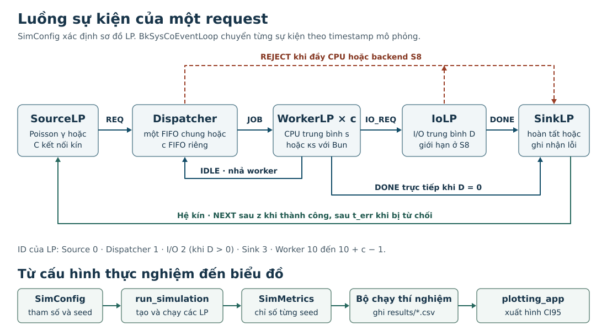
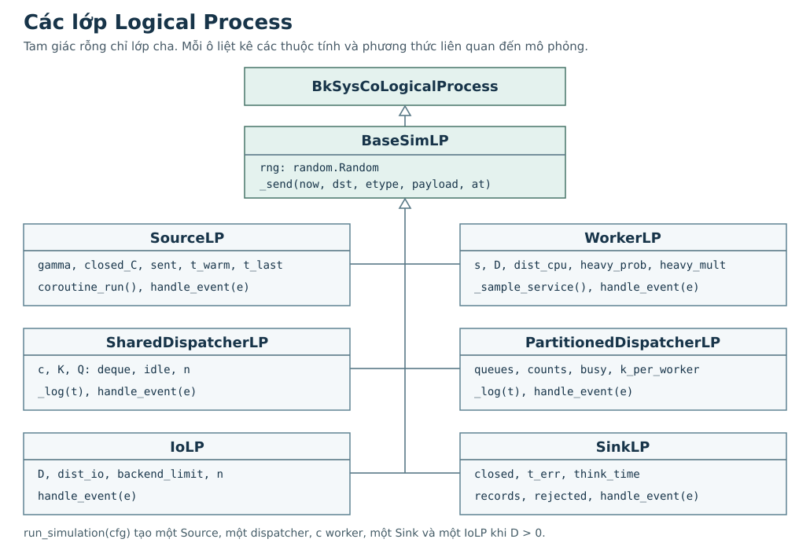

# Kiến trúc hệ mô phỏng và biểu đồ lớp

Mỗi lần chạy dựng một nguồn tải, một bộ điều phối đến trạm CPU, c worker, một trạm I/O nếu D > 0 và một bộ thu kết quả. Sơ đồ thứ nhất theo vòng đời của request, từ khi được phát tới khi hoàn thành hoặc bị từ chối. Sơ đồ thứ hai cho thấy sáu lớp LP kế thừa lớp cha nào và mỗi lớp lưu trạng thái gì.

| Mô hình của runtime | Trạm CPU trong DES | Quy tắc nhận việc |
| --- | --- | --- |
| Event loop | M/M/1/K, một worker | Một hàng FIFO, từ chối khi số đang chờ và đang chạy đạt K. |
| Spring Loom | M/M/c/K, c carrier | Một hàng FIFO chung. Worker rảnh nhận request đầu hàng. |
| Bun | c hàng M/M/1/k khi chia Poisson ngẫu nhiên, k = max(1, ⌊K/c⌋) | Mỗi worker có hàng FIFO riêng. Hàng được chọn đầy thì từ chối ngay. Dịch vụ CPU trung bình κs. |

Bảng áp dụng cho tải mở Poisson, dịch vụ mũ. Bộ mô phỏng còn hỗ trợ round-robin và thời gian phục vụ xác định. E1–E5 dùng định tuyến ngẫu nhiên cho Bun. K tính cả request đang chiếm CPU. Với Bun, dung lượng sử dụng được là c·k, thể hiện ở cột K_eff. Ba mô hình mô tả hành vi xếp hàng của runtime trên một máy chủ. Tất cả thời gian phục vụ và độ trễ đều tính theo đồng hồ mô phỏng.

Sáu lớp LP chuyên biệt cùng kế thừa BaseSimLP. Mỗi LP có bộ sinh số ngẫu nhiên riêng, khởi tạo từ seed của lần chạy và ID của LP. SourceLP (ID 0) tạo request theo tốc độ γ ở hệ mở hoặc duy trì C kết nối ở hệ kín. Hai bộ điều phối ở cùng vị trí logic (ID 1) chọn worker (ID 10 trở lên). Worker kết thúc CPU, báo IDLE và chuyển request sang IoLP (ID 2). Với D = 0, worker gửi DONE thẳng tới SinkLP (ID 3). I/O cơ sở phục vụ đồng thời mọi request. S8 đặt giới hạn kết nối và từ chối khi hết chỗ. SinkLP ghi thời gian chờ CPU, thời gian tại CPU, độ trễ toàn hành trình và nguồn từ chối. Ở hệ kín, SinkLP đánh thức SourceLP sau think time nếu thành công hoặc sau t_err nếu bị từ chối. [Các LP](../scenarios/async_runtime_lps.py) · [Bộ điều phối mô phỏng](../apps/simulator_app.py)

Simulation._create_dispatcher tự chọn BkSysCoEventLoop khi có LP kiểu coroutine. Vì sáu loại LP ở trên đều thuộc kiểu này, hai cấu hình sequential và distributed_sequential chạy cùng bộ xử lý sự kiện. Phép thử tương đương trong bộ kiểm thử kiểm tra kết quả của hai lựa chọn cấu hình trên mô hình này. [Cơ chế chọn bộ xử lý sự kiện](../bkitevsim/core/simulation.py) · [Kiểm thử bất biến](../tests/test_invariants.py)

## Dữ liệu và cách đọc

Bảy câu hỏi dưới đây theo thứ tự ở §2.2 của Phase 1. Với thời gian CPU trung bình 1 ms và I/O nhả CPU, một worker phục vụ tối đa khoảng 1.000 request/s. Dữ liệu BkitEvsim cho phép so sánh các cách tổ chức hàng đợi ở cùng tải và xác định khi nào kết quả lệch khỏi dự đoán giải tích. [Thiết kế Phase 1](<../../The Phase 1 submission/Spe-Ass-Spec-YY9B.pdf>)

| Bộ dữ liệu | Số dòng | Seed mỗi dòng | Yếu tố thay đổi |
| --- | ---: | --- | --- |
| [E1](../results/e1_throughput_curves.csv) | 44 | 29 dòng × 6, 15 dòng × 10 | Tải tuyệt đối γ chung cho bốn cấu hình, từ 200 đến 10.000 request/s. |
| [E2](../results/e2_capacity_delay.csv) | 30 | 10 dòng × 6, 20 dòng × 8 | K, số core c và phân phối thời gian CPU, ở γ = 7.500. |
| [E3](../results/e3_loom_vs_bun_sensitivity.csv) | 16 | 8 | Kiểu hàng và κ ở γ = 7.000, D hoặc s ở γ = 6.000. |
| [E4](../results/e4_closed_loop.csv) | 30 | 8 | C từ 100 đến 5.000, K hữu hạn hoặc K = 10⁹. |
| [E5](../results/e5_special_scenarios.csv) | 6 | 10 | S8 giới hạn backend và S10 có tác vụ CPU dài, kèm các cấu hình đối chứng S10. |

Dữ liệu gốc của các thí nghiệm nằm ở commit `ff8df35`. Trong 126 dòng tổng hợp E1–E5, 21 dòng đạt mức tối thiểu 10 seed trong phân công, 105 dòng dùng 6 hoặc 8 seed. Các phép quét K/c và D/s giao nhau ở bốn cấu hình. Vì vậy 122 cấu hình vật lý và 940 cặp cấu hình–seed tạo ra 972 dòng dữ liệu thô theo nhãn thí nghiệm. [Dữ liệu từng seed](../results/raw_seed_runs.csv)

Ký hiệu ± là nửa độ rộng CI95 của trung bình giữa các seed, dùng phân phối t-Student với m−1 bậc tự do và m lấy theo từng dòng. p95 và p99 là trung bình các phân vị tính riêng từng seed. Độ trễ tính trên request thành công. X đo bằng request/s, thời gian trong các bảng đo bằng ms. [Bốn nhóm biểu đồ](../results/figures/)

Cửa sổ đo bắt đầu sau warm-up và kết thúc khi nguồn phát request cuối. X tính theo số lượt hoàn thành trong cửa sổ chia cho thời gian quan sát. L_CPU và L_IO là số request trung bình theo thời gian tại mỗi trạm, tính bằng diện tích dưới đường số request chia cho thời gian quan sát. U là tỷ lệ thời gian bận trung bình trên mỗi worker. Khi xác suất từ chối đo được bằng 0, số lần từ chối quan sát được trong mẫu bằng 0.

## 1. Thông lượng và thời gian phản hồi thay đổi thế nào khi tăng tải?

Với κ = 1, Bun và Loom cùng 8 core có cùng trần CPU. Event loop cơ sở trong E1 chỉ dùng 1 core nên bão hòa trước. Mô hình event loop trong thiết kế dùng một luồng. Nếu đặt cả ba ở c = 1, cùng K và κ = 1, hai cách tổ chức hàng trùng nhau và trần lý thuyết đều là 1/s. Khi κ của Bun tăng lên 1,25, mỗi request chiếm CPU lâu hơn 25 % và trần của 8 core giảm còn 6.400 request/s.

Dùng ngưỡng X ≥ 0,95γ ở §2.3 của Phase 1, cột thứ ba ghi tải lớn nhất còn đạt và tải nhỏ nhất đã trượt trong lưới E1. Khoảng giữa hai tải này thể hiện độ phân giải của phép quét. Hai cột cuối đo tại γ = 10.000.

| Cấu hình | Trần CPU | γ đạt / trượt | X ± CI95 | Lệch trần (%) |
| --- | --- | --- | --- | --- |
| Event loop | 1 000 | 1 000 / 1 200 | 993 ± 40 | 0,70 |
| Bun, κ = 1 | 8 000 | 8 000 / 10 000 | 7 978 ± 21 | 0,28 |
| Bun, κ = 1,25 | 6 400 | 6 000 / 7 000 | 6 394 ± 36 | 0,10 |
| Loom | 8 000 | 8 000 / 10 000 | 7 975 ± 21 | 0,31 |

Ở γ = 200, cả bốn cấu hình hoàn thành khoảng 200 request/s và có R từ 51,31 đến 51,60 ms. Ở γ = 10.000, R tăng lên 151,67 ms ở Event loop, 150,10 ms ở Loom và 146,68/173,34 ms ở Bun với κ = 1/1,25. Riêng Event loop đã dùng 99,07 % CPU và có R = 104,15 ms ở γ = 1.000, khi thông lượng vẫn đạt ngưỡng 95 %.

## 2. Hàng chung và hàng riêng khác nhau bao nhiêu?

E3 giữ γ = 7.000, c = 8, K = 160, s = 1 ms, D = 50 ms. Hai hàng đầu cô lập tác động của cấu trúc hàng. Hai hàng tiếp theo đo chi phí CPU ở cùng cấu trúc Bun.

| Cấu hình | X ± CI95 | P_block (%) ± CI95 | R ± CI95 | Wq CPU |
| --- | --- | --- | --- | --- |
| Loom, κ = 1 | 6 984 ± 29 | 0,00 ± 0,00 | 51,98 ± 0,42 | 0,59 |
| Bun, κ = 1 | 6 928 ± 29 | 0,90 ± 0,26 | 56,91 ± 0,51 | 5,57 |
| Bun, κ = 1,25 | 6 271 ± 38 | 10,34 ± 0,67 | 67,10 ± 0,72 | 15,64 |
| Bun, κ = 1,5 | 5 314 ± 47 | 24,14 ± 0,76 | 75,73 ± 0,63 | 23,87 |

Ở κ = 1, hiệu Bun trừ Loom tính theo cặp cùng seed là 0,90 [0,64 – 1,16] điểm phần trăm cho P_block và 4,93 [4,62 – 5,24] ms cho R (trung bình [CI95]). Kiểm định t ghép cặp hai phía cho chênh lệch R có p = 2.4e-09. Khi một hàng riêng đã đầy, worker khác có thể còn chỗ. Hàng chung cho phép bất kỳ worker rảnh nào phục vụ request kế tiếp. Ở κ = 1,5, trần của Bun còn khoảng 5.333 request/s nên riêng tải 7.000 đã vượt năng lực CPU.

## 3. Tăng sức chứa hay tăng số core?

E2 quét K ở γ = 7.500, c = 8, s = 1 ms và D = 50 ms, thời gian CPU phân phối mũ. Loom ở dưới trần 8.000, còn Bun với κ = 1,25 vượt trần 6.400. So sánh qua các hàng của bảng cho thấy tác động của K trong từng hệ.

| K tổng | Loom P_block (%) | Loom R | Bun P_block (%) | Bun R | Bun p99 |
| --- | --- | --- | --- | --- | --- |
| 16 | 5,55 | 51,61 | 38,63 | 52,12 | 234,64 |
| 40 | 0,63 | 52,35 | 24,14 | 54,45 | 236,92 |
| 200 | 0,00 | 52,86 | 15,15 | 75,06 | 258,34 |
| 800 | 0,00 | 52,93 | 15,29 | 169,21 | 352,14 |

Tăng K có thể giảm từ chối ngay cả khi R tăng. Với Bun quá tải, phần từ chối dài hạn có sàn xấp xỉ 1 − 6.400/7.500 = 14,67 %. Từ K = 200 tới 800, hàng dài hơn chủ yếu tăng độ trễ và p99. Phép quét riêng giữ K = 200 và tăng c của hàng chung từ 4 lên 8, làm P_block giảm từ 46,81 % xuống 0,00 %, R giảm từ 100,06 xuống 52,86 ms. Với hàng riêng Bun, K = 200 và c = 16 cho 12 chỗ mỗi hàng, tức K_eff = 192. Với hàng chung của Loom, ở 16 core và đủ 200 chỗ, U giảm xuống 46,99 % và R còn 51,26 ms.

Giữ c = 8 và K = 16, đổi thời gian CPU của Loom từ phân phối mũ sang xác định cùng trung bình 1 ms cho P_block lần lượt 5,55 % và 2,94 %. p95/p99 toàn hành trình tương ứng 152,67/233,83 ms và 152,43/234,19 ms. Thời gian I/O vẫn phân phối mũ.

**Chọn cấu hình S9.** Với γ = 7.500 và 8 core, K = 40 là mức nhỏ nhất trong các mức **đã thử với Loom, CPU mũ** thỏa đồng thời bốn ngưỡng hiệu năng ở §2.3 của Phase 1 trên giá trị trung bình. P_block = 0,63 ± 0,24 %, R = 52,35 ± 0,43 ms, p99 = 234,94 ± 3,16 ms và X = 7 454 ± 34 request/s. Các ngưỡng tương ứng là dưới 1 %, 100 ms, 300 ms và ít nhất 7.125 request/s. K = 16 trượt ngưỡng từ chối.

## 4. I/O làm tăng độ trễ và thay đổi thông lượng thế nào?

Khi backend vô hạn, worker nhả CPU trước khi chờ I/O. Ở trạng thái dừng R = W_CPU + D, L_IO = X·D và trần CPU độc lập với D. E3 quét D ở γ = 6.000, c = 8, K = 160 và s = 1 ms. Loom dùng κ = 1, Bun dùng κ = 1,25. Do đó phép quét này đo X ở một mức tải. Phép đo trần khi quá tải thuộc E1 ở D = 50 ms.

| D | Loom R ± CI95 | Loom X ± CI95 | Bun R ± CI95 | Bun X ± CI95 |
| --- | --- | --- | --- | --- |
| 10 | 11,25 ± 0,09 | 5 998 ± 21 | 20,54 ± 0,52 | 5 845 ± 28 |
| 50 | 51,46 ± 0,38 | 5 996 ± 24 | 60,88 ± 0,64 | 5 842 ± 30 |
| 200 | 195,29 ± 1,61 | 5 922 ± 25 | 211,52 ± 1,87 | 5 831 ± 34 |

Tăng D từ 10 lên 50 ms làm R của Loom tăng 40,21 ms, gần mức cộng 40 ms. Tăng từ 10 lên 200 ms cho mức tăng 184,04 ms. U của Loom ở hai đầu lần lượt bằng 75,20 % và 75,20 %, còn L_IO tăng từ 60,4 lên 1 190,9 request. D dài khiến nhiều request còn ở I/O khi cửa sổ đóng, ảnh hưởng việc ước lượng X và R từ các lượt hoàn thành trong cửa sổ hữu hạn.

**Độ nhạy với s.** Tại γ = 6.000, D = 50 ms, Loom có X = 5 996, 5 996 và 4 004 request/s khi s lần lượt bằng 0,5, 1 và 2 ms. Ở 2 ms, trần CPU giảm còn 4.000 request/s và P_block đạt 33,29 %.

## 5. Kết quả mô phỏng phù hợp với nghiệm giải tích ở những điều kiện nào?

Trong sáu mô hình trạm đơn ở ba mức tải, 13/18 cấu hình đồng thời đạt ngưỡng sai số và CI95 theo phép đối chiếu chặt ở §9.4 của Phase 1. Nếu chỉ xét CI95, nghiệm giải tích của cả bốn chỉ số đều nằm trong khoảng ở 18/18 cấu hình.

**Trạm lệch nhiều nhất.** M/M/1 tải cao là dòng duy nhất trượt `Pass_5pct`. W mô phỏng bằng 70,379 ms so với giải tích 66,667 ms (lệch 5,568 %). L tương ứng là 6,0018 so với 5,6667 request (lệch 5,914 %). Ở ρ = 0,85, các đợt tích tụ có thể kéo dài. Tám seed cho CI95 của W từ 63,598 đến 77,160 ms và của L từ 5,3781 đến 6,6255 request. Cả hai khoảng chứa nghiệm giải tích. Sai số tuyệt đối P_block lớn nhất là 0,423 điểm phần trăm ở M/M/c/K tải cao. [Đối chiếu cả sáu trạm và tiêu chí kiểm chứng](../../Validation%20and%20evaluation/Validation-and-evaluation.pdf)

**Mạng CPU–I/O.** Ở E3 với γ = 7.000, ba cấu hình Bun (κ = 1, 1,25 và 1,5) có sai số tương đối của R, L_IO và P_block đều dưới ngưỡng 3 % của §9.4. Với Loom cùng tải, R lệch 0,66 % và L_IO lệch 0,55 %. Bộ mô phỏng ghi nhận 0 lượt từ chối, trong khi xác suất giải tích khoảng 1,22 × 10⁻¹⁰. Sai số tương đối của P_block ở điểm rất hiếm này là 100 %. [Giá trị đo và nghiệm giải tích E3](../results/e3_loom_vs_bun_sensitivity.csv)

**Kiểm tra theo seed ở tải mở.** Với 672 dòng E1–E3, lấy độ lệch tuyệt đối chia cho giá trị đo trên mỗi seed. Độ lệch lớn nhất giữa X·R và L_sys là 3,82 %, giữa X·W_CPU và L_CPU là 6,20 %, giữa X·s_eff/c và U là 7,05 %. Ở đây s_eff = κs cho Bun, s cho Loom và Event loop. Các tỷ lệ này mô tả sai lệch của từng cửa sổ quan sát hữu hạn trong hệ có I/O.

## 6. Thông lượng có đạt trần 1/s và c/s?

Tại γ = 10.000, cả bốn cấu hình đều quá tải. So với các trần 1/s, c/s và c/(κs), sai lệch tương đối lớn nhất của X trung bình trong bảng câu 1 là 0,70 %. Khi tải vượt trần, tăng γ chủ yếu làm tăng từ chối. Ví dụ Loom đi từ γ = 8.000 tới 10.000, X lần lượt là 7 975,16 và 7 975,22 request/s trong khi P_block đi từ 0,17 % tới 20,18 %.

## 7. Khi C lớn hơn K, tỷ lệ từ chối và quan hệ Little thay đổi thế nào?

E4 đặt think time z = 0 và t_err = 10 ms. Một kết nối chờ phản hồi thành công hoặc đợi gửi lại sau lỗi. Vì vậy C ≈ X·R + X_err·t_err ở trạng thái dừng. Bảng tính từng tích với R theo giây **trên từng seed**, sau đó lấy trung bình. Cột cuối là trung bình [CI95], đơn vị kết nối.

| Hệ | C | K | Từ chối (%) | X·R | X_err·t_err | Tổng [CI95] |
| --- | --- | --- | --- | --- | --- | --- |
| Loom | 100 | 800 | 0,00 | 100,0 | 0,0 | 100,0 [99,9 – 100,1] |
| Event loop | 1 500 | 200 | ngoài miền xác suất | 60,1 | 1 311,2 | 1 371,3 [1 365,4 – 1 377,1] |
| Bun, κ = 1,25 | 1 500 | 800 | 88,93 | 821,0 | 422,6 | 1 243,6 [1 239,5 – 1 247,6] |
| Loom | 1 500 | 800 | 82,95 | 948,3 | 342,6 | 1 290,9 [1 283,8 – 1 297,9] |
| Loom | 5 000 | 800 | ngoài miền xác suất | 236,7 | 4 274,9 | 4 511,6 [4 504,0 – 4 519,1] |
| Loom | 5 000 | 10⁹ | 0,00 | 4 644,6 | 0,0 | 4 644,6 [4 640,1 – 4 649,1] |

Ở K hữu hạn, **7/30 cấu hình E4 có giá trị P_block trung bình vượt 1**, gồm Event loop ở C = 1.500, 3.000 và 5.000, cùng Bun và Loom ở C = 3.000 và 5.000. Cả 56 dòng seed của bảy cấu hình đều có vấn đề này. Ví dụ Event loop tại C = 5.000 có tỷ số trung bình 1,103410. Source đếm lượt đến theo thứ tự sau warm-up, còn bộ đếm từ chối lấy cả các lượt đến trùng timestamp tại biên trái. Các kết nối hệ kín có thể gửi đồng thời tại biên này. Vì hai tập đếm khác nhau, bảy tỷ số chỉ ra sai lệch phép đo. Bảng ghi “ngoài miền xác suất” và giữ nguyên các số đếm nguồn. [Logic đếm lượt đến](../scenarios/async_runtime_lps.py) · [Cửa sổ và bộ đếm từ chối](../apps/simulator_app.py)

Ở C = 1.500, K = 800, các tỷ lệ CSV của Bun và Loom lần lượt là 88,93 % và 82,95 %. C lớn hơn K vẫn cho phép một phần kết nối nằm tại I/O hoặc đang chờ gửi lại. Thành phần X_err·t_err vì thế cần xuất hiện trong phép đối chiếu Little. Các đại lượng trong bảng là **ước lượng từ cửa sổ hữu hạn**. Trong 30 dòng, 16 dòng có sai lệch của tổng so với C dưới 3 %. Sai lệch lớn nhất là 23,32 % tại Bun, K hữu hạn, C = 3.000. Cấu hình này cũng có P_block ngoài miền hợp lệ. Trong 23 dòng có P_block trung bình từ 0 đến 1, 14 dòng đạt mức 3 %, sai lệch lớn nhất là 17,09 % tại Bun, K = 800, C = 1.500. Các lượt qua biên cửa sổ và cách đếm từ chối giới hạn việc suy ra trạng thái dừng từ E4. [Dữ liệu E4](../results/e4_closed_loop.csv)

## Kịch bản bổ sung về nghẽn CPU và I/O

Ở E1 tại γ = 7.000, κ = 1, Bun có trung bình 57,28 request tại CPU và Wq = 7,16 ms. Hàng chung của Loom có 11,98 request và Wq = 0,70 ms. L_CPU bao gồm request đang chạy. Ở trạm I/O vô hạn, request đang chờ kết quả I/O đều đã vào phục vụ. S8 và S10 cho thấy hai cơ chế gây lỗi khác nhau.

| Cấu hình | Từ chối CPU (%) | Từ chối I/O (%) | X ± CI95 | R | p99 |
| --- | --- | --- | --- | --- | --- |
| S8 · Loom | 0,00 | 16,35 | 5 852 ± 41 | 52,15 | 236,11 |
| S8 · Bun, κ = 1,25 | 8,74 | 8,31 | 5 785 ± 36 | 100,84 | 286,72 |
| S10 · Event loop, 0 % | 0,00 | 0,00 | 898 ± 4 | 60,27 | 242,51 |
| S10 · Event loop, 5 % | 42,45 | 0,00 | 517 ± 13 | 431,44 | 739,75 |
| S10 · Loom, 5 %, K = 200 | 0,00 | 0,00 | 901 ± 3 | 52,22 | 234,70 |
| S10 · Loom, 5 %, K = 800 | 0,00 | 0,00 | 901 ± 3 | 52,22 | 234,70 |

Trong S8, backend có 300 kết nối, D = 50 ms nên chỉ phục vụ tối đa khoảng 6.000 request/s. Với Loom, I/O giữ trung bình 295,27 trong 300 chỗ, giải thích mất request tại backend dù CPU còn rảnh. Hai tỷ lệ từ chối cùng chia cho số request tới hệ thống nên có thể cộng trực tiếp.

Trong S10, 5 % request có thời gian CPU trung bình gấp 20 lần. Nhu cầu CPU trung bình thành 1,95 ms, trần event loop còn khoảng 513 request/s trong khi γ = 900. Wq tăng từ 8,91 lên 379,43 ms. Giữ K = 200 và chuyển sang 8 worker, một tác vụ dài chỉ chiếm một worker. Điều này giải thích mức giảm p99 ở hàng Loom cùng K trong bảng. [Kịch bản S8 và S10](../results/e5_special_scenarios.csv)
